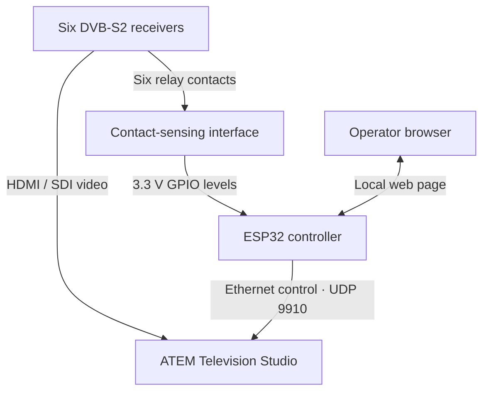

# DATV receiver lock → ATEM controller

Two maintained deployment targets watch six DVB-S2 receiver lock/alarm inputs and
select the associated video input on an **original six-input Blackmagic ATEM
Television Studio**:

- **LattePanda 3 Delta / Linux Mint**, using the onboard Arduino over internal USB.
  Start with the [LattePanda deployment guide](docs/lattepanda.md).
- **ESP32**, retaining the Olimex Ethernet and generic Wi-Fi firmware builds below.

Both use the same arbitration, Program coordinator, ATEM protocol code and local
web dashboard. The dashboard provides manual switching, actual Program/Preview
feedback, live alarm status and persistent configuration.

This installation uses **Harmonic ProView 7100** receivers. Their documented GPI
outputs are configurable **dry relay contacts**, so the input interface must sense
contacts using its own supply. See the [ProView compatibility and monitoring
review](docs/receivers/harmonic-proview-7100.md) before wiring or arming automation.

The configured receiver alarm must represent valid decoded video. Video connects
directly from each receiver to the ATEM; the selected controller handles alarm inputs and
Ethernet control only. It sends the ATEM's UDP control protocol on port **9910**.
It does not use RS-232 or the ATEM's USB port.

The standalone ESP32 deployment is shown below; the LattePanda replaces it with
an onboard Arduino input reader plus a Linux host service.



**Status: initial implementation, compiled and tested in software. Physical
LattePanda/ESP32/receiver/ATEM commissioning is still required.** See
[deployment](docs/deployment.md) and [validation](docs/validation.md).
Receiver SNMP/XML polling and trap reception are **not implemented** in this
version; the current lock indications come from qualified GPIO inputs.

## Included

- Six independently enabled, named alarm channels mapped to ATEM inputs 1–6.
- Separate acquisition and loss qualification timers to filter alarm chatter.
- Three selectable policies for multiple locked receivers: rotation, priority,
  or a designated source after a continuous multiple-lock delay.
- Configurable no-lock fallback: ATEM Black or any input 1–6.
- Program/Preview selection, Cut, Auto transition, and Fade to black from the web
  page. Automatic source selection uses a direct Program cut.
- Actual ATEM feedback drives tallies; accepting a command does not assert that
  it has reached Program.
- Pause/resume automation, optional pause on external Program changes, event
  history, network/ATEM status, and saved settings.
- Device-specific web credentials, authenticated JSON control requests, setup
  Wi-Fi, and a locally embedded dashboard with no external web dependencies.
- Session handshake, ACKs, retries, duplicate handling, sequence rollover,
  feedback resynchronization, and reconnect handling for ATEM control.

## Default switching behavior

**Every boot starts with automation paused.** Settings persist; arming does not.
Inspect the lock indications and ATEM connection, then choose **Resume Auto**.

| Condition while Auto is enabled | Result |
| --- | --- |
| Exactly one receiver qualifies | Take its mapped input to Program |
| Several receivers qualify | Rotate among qualified sources every 300 seconds |
| The selected receiver loses lock | After the loss qualification time, choose another qualified receiver |
| No receiver qualifies | Take the configured fallback, initially Black |
| A manual Take/Cut/Auto/FTB is requested | Pause automatic selection |
| An unexpected external Program change is observed | Pause by default; configurable |
| ATEM feedback is unavailable | Stop new control requests until the state is synchronized |
| Configuration is saved | Pause and restart input qualification |

Lock acquisition defaults to **1,000 ms**; lock loss defaults to **2,000 ms**.
The rotation timer begins when multiple qualified receivers first compete.
Additional receivers joining do not continually restart that timer. All six
inputs participate in physical alarm-channel order. Priority determines the
initial choice and is the whole selection rule in priority mode.

The alternative **Selected source after delay** policy takes a chosen input
after two or more receivers remain locked for the configured interval. That
designated source is selected even without its own alarm lock. This is a
continuous-overlap timer, not a rolling history of receiver events. See the
[complete behavior description](docs/behavior.md).

## Hardware targets

The primary host target is now **LattePanda 3 Delta running Linux Mint**. The
onboard Arduino reads six conditioned inputs on D4–D9 through internal USB CDC.
The Linux host serves the dashboard and controls ATEM over Ethernet. Arduino
status loss pauses automation and displays inputs as unknown; restoration requires
explicit rearming. [Build and install the Mint service](docs/lattepanda.md).

### Standalone ESP32 option

Use the **Olimex ESP32-POE-ISO, standard ESP32-WROOM variant**, an appropriately
conditioned six-channel contact-sensing interface, and wired Ethernet. The board has
PoE and a USB programmer. Its PoE isolation does **not** isolate alarm GPIOs.

| Build target | Board | Alarm GPIOs | Default asserted level at ESP32 |
| --- | --- | --- | --- |
| `esp32-poe-iso` | Olimex ESP32-POE-ISO, WROOM | 4, 13, 14, 32, 33, 36 | LOW; configure polarity to match the verified contact/interface behavior |
| `esp32dev_wifi` | Generic ESP32-WROOM development board | 16, 17, 18, 19, 21, 22 | HIGH, for known 3.3 V bench logic |

The original powered **HIGH = video lock** assumption is superseded by the
identified ProView's relay interface. A contact can pull a controller-side input
LOW when closed, but the relay's healthy, fault and power-off behavior must be
measured before choosing the firmware's per-channel polarity. An NC contact is
not automatically a power-loss-safe indication of healthy video.

**Do not connect an unknown, 5 V, 12 V, or 24 V alarm directly to ESP32 GPIO.**
The ProView contact supplies no alarm voltage. Verify the actual connector
revision, relay/contact specifications and complete fault behavior to finish the
input circuit. GPIO13 and GPIO36 also have existing pull-ups on the Olimex board.
Read the [pin table and wiring guide](docs/hardware.md).

## ESP32 build and install

Install [PlatformIO](https://docs.platformio.org/en/latest/core/installation/index.html),
open this directory, and build the intended board:

```sh
pio run -e esp32-poe-iso
pio run -e esp32-poe-iso -t upload
pio device monitor -b 115200
```

Use `esp32dev_wifi` instead for the Wi-Fi bench target. The pinned environment is
Espressif32 **6.9.0**, Arduino ESP32 **2.0.17**, and ArduinoJson **6.21.5**.
The web assets are compressed and embedded during the build; no separate
filesystem upload is needed. Updates use USB; web OTA is not implemented.

1. Read the generated password and network address from the serial monitor.
   Web username: **admin**.
2. Connect the controller and ATEM to the same reachable control network. The
   controller uses DHCP. Open `http://<controller-ip>/`.
3. With no network uplink, the Olimex starts a password-protected setup AP after
   15 seconds. A Wi-Fi bench board with no SSID starts its AP immediately. The AP
   password is the generated device password; its address is printed on serial.
4. Set the ATEM IPv4 address, alarm mappings, GPIO polarity, and switching policy.
   ATEM address starts blank. Network changes require **Restart controller**.
5. Confirm manual control and actual video first. Verify each alarm and its
   associated source, then explicitly **Resume Auto**.

Detailed instructions and acceptance checks are in
[docs/deployment.md](docs/deployment.md).

## Video compatibility

The original Television Studio has six usable external input channels. HDMI and
SDI sockets shared by channels 3 and 4 do not create additional independent
sources. All connected video must match the switcher's configured production
standard. Frame synchronization is not arbitrary resolution/frame-rate
conversion. Receiver lock alone cannot prove the ATEM accepts that receiver's
video output. Configure production format and the shared HDMI/SDI inputs using
the appropriate Blackmagic software before testing this controller.

This dashboard implements the listed switching controls. It does not configure
ATEM video standards, HDMI/SDI connector selection, audio mixing, media pools,
keyers, or firmware updates.

## Development and tests

```sh
python scripts/test_native.py
python3 linux/build.py
python3 -m unittest discover -s test/linux -v
python3 -m platformio run -d firmware/lattepanda-inputs
npm ci --ignore-scripts
npm test
pio run -e esp32-poe-iso -e esp32dev_wifi
```

Native tests require a C++17 compiler and Python 3. Dashboard tests use Node.js
and development-only jsdom; neither is needed on the ESP32. GitHub Actions runs
these checks, both ESP32 firmware builds and the onboard Arduino compile check. See [test scope](docs/validation.md).

## Documentation and code

| Area | Location |
| --- | --- |
| LattePanda / Mint deployment and internal USB firmware | [docs/lattepanda.md](docs/lattepanda.md) |
| Linux service and shared-core bridge | [linux](linux) |
| Onboard Arduino input firmware | [firmware/lattepanda-inputs](firmware/lattepanda-inputs) |
| Field wiring and board selection | [docs/hardware.md](docs/hardware.md) |
| ProView 7100 contacts, video/RF compatibility and proposed network monitoring | [docs/receivers/harmonic-proview-7100.md](docs/receivers/harmonic-proview-7100.md) |
| ProView firmware collection and ordered implementation checklist | [docs/receivers/proview-next-steps.md](docs/receivers/proview-next-steps.md) |
| Build, network setup, commissioning | [docs/deployment.md](docs/deployment.md) |
| Timer and selection semantics | [docs/behavior.md](docs/behavior.md) |
| HTTP control API | [docs/api.md](docs/api.md) |
| Validation and remaining hardware checks | [docs/validation.md](docs/validation.md) |
| Input qualification and arbitration | [lib/Arbitration](lib/Arbitration) |
| Program confirmation and operator takeover | [lib/ProgramCoordinator](lib/ProgramCoordinator) |
| ATEM transport and protocol references | [lib/AtemClient](lib/AtemClient) |
| Firmware integration and saved settings | [src](src) |
| Embedded dashboard | [web](web) |

ATEM protocol work references the MIT-licensed Sofie project; its notice is
retained in [THIRD_PARTY_NOTICES.md](lib/AtemClient/THIRD_PARTY_NOTICES.md).
Dependencies retain their respective licenses. Product names belong to their
respective owners. This project is not affiliated with Blackmagic Design.
